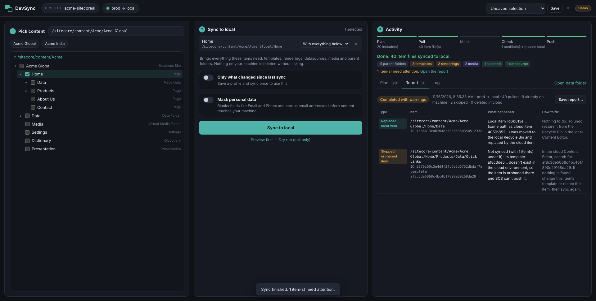

# DevSync for SitecoreAI

**Pull real content from a SitecoreAI cloud environment into your local Docker CM, in a few clicks.**

Sitecore's tools move content cloud ↔ cloud (Content Transfer / Item Transfer APIs) and XP → cloud (SitecoreAI Pathway). Getting cloud content *down to a developer laptop* still means hand-writing module JSON, running `ser pull` / `ser push` by hand, and guessing which datasources and media a page needs. DevSync replaces that with a desktop app:

1. **Open** your solution once. DevSync remembers the project, the environments and how you signed in, and reconnects by itself next time.
2. **Pick** pages or folders in the live content tree.
3. **Sync to local**. There are no options to set. DevSync brings everything they need: templates (with their whole base-template chain), renderings, datasources, media and missing parent folders, in the right order. Then it pulls from the cloud, optionally masks personal data, and pushes into your local CM.

Save the selection as a profile, and next time flip **"Only what changed since last sync"**.



---

## Features

| | |
|---|---|
| Tree picker | Browse the cloud content tree with site shortcuts or by path. For each selection choose *this item only*, *with children* or *with everything below*. |
| Brings everything they need | Always on, no settings. It reads field values (including `__Final Renderings`) and adds datasources, linked content and media, following up to 3 levels. It also adds **the template of every synced item, all base templates to the end of the chain, renderings, rendering datasource and parameter templates, and the templates of parent folders**. Built-in `/sitecore/templates/System` items are skipped. |
| Never pulls what you already have | Before pulling, DevSync asks the local CM which templates, renderings and parent folders already exist **with the same ID**: Sitecore's own items (System, SXA/JSS Experience Accelerator…) ship in both images, and your repo's serialized items are already pushed. Those are skipped. If the local API can't be reached, a list of Sitecore product folders is used instead. Content you selected is always synced. |
| Orphaned items don't block the sync | An item whose template exists in neither the cloud nor the local CM can't be pushed by SCS. DevSync leaves it out (with everything under it), syncs the rest, and tells you which item and template ID. Templates and renderings are never left out. |
| Templates anywhere | Any item used as a template (or listed in `__Base template`) is treated as a template, even outside `/sitecore/templates` (for example generated component templates), and is pushed before the content that uses it. The null ID `{00000000-…}` that SXA/JSS base templates use for "no base" is ignored. If the API rejects a batch of lookups, IDs are resolved one by one, then with a language, then through the search index. |
| Templates are always complete | After the pull, DevSync reads the template ID of **every pulled item** (and the base templates of every pulled template) and fetches anything missing before pushing. Scan limits can't cause "Template ID … did not exist". If the local CM still reports a missing template, DevSync pulls that exact template and retries the push automatically (up to 3 times). |
| Handles "same path, different ID" | When a local site or folder was created separately from the cloud one, SCS refuses to push (*"attempted to be cached … with different ID. Non-unique paths cannot be serialized"*). Before pushing, DevSync pulls a snapshot of the same paths from your local CM, finds every conflict (reported at the topmost path), and asks: **Replace local** (moved to the local Recycle Bin, with a file backup in the data folder) or **Keep local, skip these**. Conflicts that only appear during the push are resolved the same way, then the push is retried. |
| Exact, ID-based cleanup on the local CM | Conflicting local items are removed **by ID** through the local CM's Authoring API (using your CLI login), so it also works when the local CM has two items with the same name. Items go to the **local Recycle Bin** (`permanently: false`), so you can restore them there. Writes are only possible against `localhost`/`*.localhost` hosts: the client refuses write access to any other host, and the cloud client blocks all mutations. If the local API can't be reached, DevSync falls back to serialization-only handling and, for duplicates, tells you exactly which local ID to delete. |
| Duplicate names in the cloud | Two cloud siblings with the same name can't be serialized. DevSync excludes that path with an SCS `Ignored` rule, warns you, and syncs everything else. |
| Your local definitions are safe | Templates and renderings are pushed **create-if-missing** (`CreateOnly`, whole template subtree), so a template you're changing on your branch is never overwritten. |
| Remembers where you left off | Last project, environments, sign-in mode and profile are kept in the app's settings. On launch it reopens the project and reconnects automatically. |
| Delta sync | Uses the master index to find items updated since the last successful sync and pulls only those, with their dependencies. |
| Safe by default | Read-only against the cloud (GraphQL mutations are blocked in code). Pushes only to `localhost` / `*.localhost` hosts. Default push mode never deletes local items. Parent folders are created *create-only*. |
| PII masking | Blanks named fields (Email, Phone, …) and scrubs email addresses from serialized YAML *before* the push. |
| Profiles | Save sync sets ("Homepage + Products") and reopen them with one click. They're stored per user in the data folder, not in the repo. |
| Nothing added to your repo | All of DevSync's files (CLI workspaces, pulled items, backups, profiles, history, reports) live in its own data folder: `%LOCALAPPDATA%\DevSync\projects\<id>\` on Windows. The project's `.config/dotnet-tools.json` and `nuget.config` are copied there, so the same CLI and plugins run. Pulled item files are deleted after each sync, and the newest 5 backups are kept. The only project file DevSync touches is `.sitecore/user.json`, and only the token fields the CLI refreshed. An older `<project>/.devsync` folder is migrated, and DevSync offers to delete it. |
| Every language | **"Only what changed"** searches for changes in every language defined in the cloud and merges the results, so an item edited only in `fr-FR` is found. SCS then pulls the item with all its languages. After the pull, references in **every language's** field values (for example a datasource used only in the `fr-FR` layout) are fetched too. A language the content uses but your local CM lacks is added (create-only); local language items are never replaced, because Sitecore matches versions by language name. The Report shows changes per language. If the cloud index can't filter by language, DevSync uses one search across languages and says so in the report. |
| Cloud deletions and moves | After each successful sync DevSync stores a small item-ID manifest (ID → path) for the selected trees, in the data folder. Next time, an ID that is no longer in the cloud is **confirmed by a direct lookup** (the index alone is never trusted) and the local item is moved to the **Recycle Bin**. Only items DevSync synced are removed, only the top item of a deleted subtree, and only within the current selection. Items moved in the cloud are synced to their new path. Dry runs only list them. Without the local API, the report lists the IDs to delete. |
| Sync report | Every sync, including failed ones, produces a report: status, counts, and every item that needs attention (orphaned items, duplicate cloud names, conflicts replaced or kept), each with its path, ID, template ID, what happened and **how to fix it**. It's shown in the **Report** tab, and **Save report…** saves it as HTML (to share) or CSV (for Excel). The last 20 reports are kept in the data folder. |
| Headless CLI | `devsync run --profile "Homepage"` for scripts and onboarding. |
| Demo mode | Open `src/renderer/index.html` in a browser for a working demo with sample data. |

## Requirements

- A SitecoreAI (XM Cloud) solution with the **Sitecore CLI** restored (`dotnet tool restore`), including the Serialization and XM Cloud plugins
- **.NET 8 SDK**
- The local Docker environment running (`https://xmcloudcm.localhost` or similar)
- A cloud environment endpoint in `.sitecore/user.json`. If you only ran `dotnet sitecore cloud login`, use **+ Add cloud environment** in the app: it lists your projects and environments and runs the official `cloud environment connect` for you (read-only). Or do it by hand:
  ```powershell
  dotnet sitecore cloud login
  dotnet sitecore cloud environment connect --environment-id <id>      # creates e.g. "prod" / "dev"
  dotnet sitecore connect --ref xmcloud --cm https://xmcloudcm.localhost --allow-write true -n local
  ```
- Node.js 18+ (only to run from source or build the installer)

## Run it

```powershell
npm install
npm start
```

Build a Windows installer and a portable .exe (run on Windows):

```powershell
npm run dist:win
```

## Authentication

| Mode | When to use | How |
|---|---|---|
| **CLI login session** | Day-to-day developer use | Reuses the token from `dotnet sitecore cloud login`. If it has expired, DevSync tries a refresh in memory; if that fails, log in again. |
| **Automation client** (recommended for teams) | Stable, no interactive login | In the Deploy app: **Credentials → Environment → Create credentials → Automation**. Paste the client ID and secret. They are stored encrypted with the OS keychain (Electron `safeStorage`), never in the project. Use an *environment* client, not an organization client (least privilege). |

## How it works

Pipeline per sync:

1. **Plan**: selections, references, templates, renderings, parent folders, in push order.
2. **Pull** from the cloud. Duplicate cloud names are excluded. Then every pulled item's template and base templates are checked, and anything missing is fetched.
3. **Mask** personal data (optional).
4. **Check**: pull a snapshot of the same paths from the local CM and compare IDs. Conflicts are replaced (with backup) or skipped.
5. **Push** to the local CM. A missing template or a late conflict reported by the CM is repaired, then the push is retried.

```
 Cloud CM (read-only)                       DevSync                                Local CM
 ───────────────────                        ───────                                ────────
 Authoring GraphQL API  ──tree, fields──▶  plan builder
   /sitecore/api/authoring/graphql/v1        • selections
                                             • referenced IDs → datasources/media
                                             • parent folders (CreateOnly)
                                             • de-overlap + order (templates → layout → media → content)
                                                    │
                                                    ▼
                                           <data folder>/workspace/
                                             sitecore.json      (plugins copied, one module)
                                             DevSync.module.json
                                             .sitecore/user.json (copy)
 dotnet sitecore ser pull -n <cloud>  ◀──────────── │
                                             items/*.yml ──mask PII──┐
                                                                     └──▶ dotnet sitecore ser push -n <local>
```

- **Why a separate workspace (outside the repo)?** SCS only allows an item to appear in one include across all modules. Running DevSync's generated module next to your repo's modules would clash. In the workspace it can't.
- **Tokens:** the CLI may refresh tokens while it runs in the workspace. DevSync copies only the refreshed token fields back to your `.sitecore/user.json`, so your own CLI session keeps working. A backup goes to `user.json.bak` in the data folder.
- **Every run** writes a report (`reports/` and `last-report.json` in the data folder). The **Open data folder** link in the app goes straight there.
- Profiles are saved per user and project in the data folder, not in the repo.

### Push rules

| | Selected trees | Datasources and media | Templates and renderings | Parent folders |
|---|---|---|---|---|
| **Safe** (default) | `CreateAndUpdate` | `CreateAndUpdate` | `CreateOnly` | `CreateOnly` |
| **Mirror** | `CreateUpdateAndDelete` | `CreateAndUpdate` | `CreateOnly` | `CreateOnly` |
| + "Overwrite existing local templates" | | | `CreateAndUpdate` | |

Include order is always: templates → layout → media → content, shallow to deep, so a template exists before any item that uses it.

## Why serialization (SCS) and not the Content Transfer API?

The Content and Item Transfer APIs are a good fit for cloud → cloud, but not as DevSync's default:
- They require the **Organization Admin/Owner** role. Most developers don't have it.
- Sitecore documents them for SitecoreAI environments, with Azure Blob Storage on the destination. Local Docker support isn't documented.
- Their merge strategies work by item ID, so an item at the same path with a different ID is **not** removed. You end up with two items of the same name, and `local:/Data/...` datasources resolve to whichever comes first.

A Transfer API engine for cloud → cloud (for example prod → dev) is on the roadmap.

## Headless CLI

```powershell
node bin/devsync.js endpoints
node bin/devsync.js profiles
node bin/devsync.js plan --profile "Homepage + Products"
node bin/devsync.js run  --profile "Homepage + Products" [--delta] [--dry-run]
```

Set `DEVSYNC_CLIENT_ID` / `DEVSYNC_CLIENT_SECRET` to use an automation client. Otherwise the CLI login session is used.
To let the headless CLI call the local CM's API, trust the local dev certificate: set `NODE_EXTRA_CA_CERTS` to the `rootCA.pem` in the folder `mkcert -CAROOT` prints. The desktop app uses the Windows certificate store, so it needs nothing.

## Troubleshooting

| Symptom | Cause / fix |
|---|---|
| Source shows only `xmCloud · xmclouddeploy-api…` or *"No cloud environment connected"* | `xmCloud` is the CLI **login** endpoint (Deploy API), not a CM. Use **+ Add cloud environment**, or run `dotnet sitecore cloud environment connect -id <envId>`, then reopen the project. |
| *"No Authoring API found … (404)"* | The endpoint host isn't a SitecoreAI CM (`xmc-….sitecorecloud.io`). Reconnect the environment. |
| *403 Access denied* | Your user or automation client has no access to that environment. |
| An item is skipped as *orphaned* | Its template doesn't exist in the cloud (the template was deleted, but the item still points to it), so SCS can't push it. DevSync leaves out that item and everything under it, syncs the rest, and names the template ID. In the cloud Content Editor, search for that ID: if nothing is found, change the item's template or delete the item. |
| *"Template ID … did not exist"* on push | v0.6.0 fixes the cases seen so far: templates outside `/sitecore/templates`, and lookups that failed because of the null ID. DevSync fixes this itself: it checks the templates of every pulled item, and retries the push after fetching any template the local CM reports missing. If it still fails, the error names the template ID. Look it up in the cloud Content Editor, because it may have been deleted there. |
| *"not configured to allow writing data"* on pull | Fixed in v0.1.2: DevSync enables `allowWrite` only in its private workspace copy of `user.json`. |
| *"attempted to be cached, but the cache already contained … with different ID"* | DevSync detects it and asks whether to replace or keep your local items. From v0.5.0 it also handles **duplicate names on the local CM** (for example a local `Data` and the cloud `Data` side by side, left by an earlier attempt) by moving the extra local item to the Recycle Bin by ID. Headless: `--on-conflict replace` or `--on-conflict skip`. |
| *"Could not use the local CM's Authoring API"* | The local CM's API couldn't be reached with your CLI login. Check that `https://xmcloudcm.localhost/sitecore` opens without a certificate warning, and run `dotnet sitecore cloud login` again. DevSync still works without the API, but it can't fix duplicate names automatically. |
| *"The local CM is not reachable"* | Start the containers (`up.ps1`) and check that `https://xmcloudcm.localhost/sitecore` opens. |
| *"Your Sitecore login has expired"* | Run `dotnet sitecore cloud login` in the project folder. |
| Stuck on *"checking references in all languages"* (v0.11.0) | Fixed in v0.12.0. Rendering `uid`s and `__Revision` values were read as item IDs, and each unknown ID was looked up again three times, one by one. Now unknown IDs are not retried, lookups run in parallel and the Log shows *"checked N of M"*. |
| Cancel does nothing, or the button stays on *Working…* | Fixed in v0.12.0. Cancel now stops API calls and every step, and on Windows ends the whole `dotnet` process tree. The run ends with a **Cancelled** report. If you cancel during the push, items pushed before that stay. Run the sync again to finish. |
| *"… did not answer within 60 seconds"* | Each API request times out after 60 s and is retried once. Check that the environment is up. To change the limit, set `DEVSYNC_API_TIMEOUT_MS`. |
| *"… printed nothing for 10 minute(s) and was stopped"* | A Sitecore CLI command produced no output for 10 minutes. It's usually a lost connection or an expired login. Run `dotnet sitecore cloud login`. To change the limit, set `DEVSYNC_CLI_IDLE_MS`. The CLI never gets keyboard input, so a login prompt fails straight away instead of waiting. |
| Can't change the site, tree, selection or profile | While a preview or sync runs, everything that feeds it is locked so the run matches what you see. Wait for it to finish, or click **Cancel**. |
| *"did not return JSON"* when loading projects | Run `dotnet sitecore cloud login` first, and check that the XM Cloud plugin is in `sitecore.json`. |

## Known limitations (v0.1)

- **Replace removes local work at the conflicting paths.** It goes to the local Recycle Bin, and a file backup is kept in the data folder (`backups/<time>/`). To restore, copy those files into an SCS module and push them after removing the cloud version.
- **Deletion detection starts after the first full sync with v0.10.0** (it needs a manifest of what was synced).
- The API reference scan covers up to 1,000 items per selection in the default language. After the pull, every pulled item is checked in every language, for both references and templates, so nothing is missed.
- A language version deleted in the cloud (while the item stays) isn't removed locally by "only what changed". A full sync re-pulls the whole item.
- Media is pulled through SCS, so large media libraries are slow. Select media folders deliberately.
- Delta and deep scan use the `sitecore_master_index`. If the index is stale, DevSync falls back to walking the tree.
- The Authoring API field `hasChildren` is detected at runtime. On schemas without it, every node shows an expand arrow.

## VS Code extension

The same app also runs inside VS Code, in [`extension/`](extension/README.md). It opens the same full-screen UI in an editor tab, themed to match VS Code, served by the same host layer (`src/host/handlers.js`). It adds **Pull latest from cloud** on any serialized `.yml`, a **Log in** prompt when the CLI login expires, and `vscode://` links for a Page Builder "Sync this page" handoff.

```powershell
cd extension
npm install
npm run package        # builds dist/extension.js and devsync-sitecoreai-<version>.vsix
code --install-extension devsync-sitecoreai-0.1.0.vsix
```

## Tests

```powershell
npm test                                  # engine tests: fake Authoring API + an SCS simulator (test/fake-scs.js)
                                          # with a stateful local CM: scopes, rules, path/ID collisions,
                                          # templates, parents, create/update/delete, token rotation
xvfb-run npx electron test/ui-smoke.js    # UI smoke test in demo mode (Linux CI)
cd extension && npm test                  # extension host through a fake vscode API + real TLS tests
cd extension && xvfb-run -a ../node_modules/.bin/electron --no-sandbox test/webview-smoke.js
                                          # the real UI over the webview bridge, dark + light themes
```

## Project layout

```
src/core/       engine (no Electron dependency): auth, GraphQL client, dependencies, delta, plan, mask, workspace, profiles, sync
src/host/       request handlers shared by the desktop app and the VS Code extension
src/main/       Electron main process + preload (context-isolated IPC)
src/renderer/   UI (vanilla JS, strict CSP) + demo.js mock
bin/devsync.js  headless CLI
extension/      VS Code extension (bundles src/core with esbuild)
test/           node:test suites and the UI smoke test
```

## Roadmap ideas

- Content Hub asset sync (pull DAM assets referenced by local pages)
- "Sync this page" button as a Sitecore Marketplace app that hands off to VS Code or DevSync
- Scheduled background sync

License: Apache-2.0
