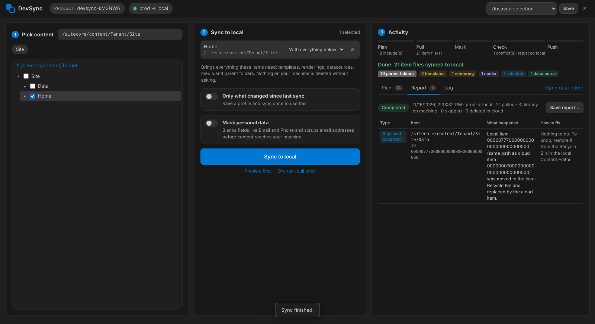

# DevSync for SitecoreAI (VS Code)

Pull real content from a SitecoreAI cloud environment into your **local Docker CM**, with everything it depends on, without leaving VS Code.

Open DevSync, tick a page in the content tree and run **Sync to local**. DevSync brings the page and its templates, base templates, renderings, datasources, media and parent folders, then pushes them into your local CM with the Sitecore CLI.

It is read-only against the cloud and only ever pushes to a `localhost` CM.

## What you get



DevSync opens as a **full editor tab** with the same three-column screen as the DevSync desktop app: pick content, sync to local, and live activity. It follows your VS Code color theme (dark, light or high contrast).

- **Pick content.** A site switcher, a content tree with checkboxes, and a path box to jump anywhere.
- **Sync to local.** A scope per item, *Only what changed since last sync*, *Mask personal data*, then **Sync to local**, **Preview first** or **Dry run**.
- **Activity.** Live steps (Plan → Pull → Mask → Check → Push), the plan, a run report and the full log.
- **All dependencies.** Templates, base templates, renderings, datasources, media and parent folders are found automatically. Items your local CM already has with the same ID, such as Sitecore's own templates, are skipped.
- **Changes in every language**, and **cloud deletions**: items removed in the cloud go to the local Recycle Bin, but only items DevSync synced.
- **Conflict handling.** If a local item has the same path but a different ID, you choose: replace it (backed up first, then sent to the Recycle Bin) or keep it.
- **Profiles.** Save a selection and rerun it. Profiles are shared with the desktop app.
- **Pull latest for one file.** Right-click a serialized `.yml` item and choose **DevSync: Pull latest from cloud**.
- **Safe runs.** Inputs are locked while a run is going. Cancel stops it at any point, and closing the tab or VS Code cancels it.

## Requirements

- A SitecoreAI solution open in VS Code (the folder with `sitecore.json`)
- The .NET SDK, and the Sitecore CLI restored in the project (`dotnet tool restore`)
- Your local Docker CM running, for example `https://xmcloudcm.localhost`
- A Sitecore Cloud login in the project (`dotnet sitecore cloud login`), or an automation client ID and secret

## Getting started

1. Open your SitecoreAI solution folder. DevSync uses it as the project automatically.
2. Click the DevSync icon in the Activity Bar, or **DevSync** in the status bar. DevSync opens as an editor tab.
3. In the connection dialog, pick the cloud environment and your local CM, then **Connect**. If the environment isn't listed, use **Add cloud environment**.
4. Tick items in the tree, then click **Sync to local**.

If your Sitecore CLI login has expired, DevSync offers **Log in**. It runs `dotnet sitecore cloud login` in a terminal and reconnects by itself when you finish.

## Settings

| Setting | Default | What it does |
|---|---|---|
| `devsync.localCaCertificate` | | Path to the root certificate (`rootCA.pem`) that signed your local CM's certificate, if DevSync can't verify it on its own |
| `devsync.dotnetPath` | | Path to `dotnet` if it isn't on your PATH |
| `devsync.apiTimeoutSeconds` | `60` | Timeout for one SitecoreAI API request (retried once) |
| `devsync.cliIdleMinutes` | `10` | Stop a Sitecore CLI command that prints nothing for this long |

## Opening from Page Builder

The extension handles links like this:

```
vscode://uday0508.devsync-sitecoreai/sync?host=<cm host>&item=<item id>&lang=<language>&scope=SingleItem
```

A Sitecore Marketplace panel can send the open page to VS Code with one of these links. Every value is validated: the host must be a `*.sitecorecloud.io` environment already connected to your project. Nothing syncs until you confirm.

## Security and privacy

- DevSync blocks every write to cloud environments, and refuses any push target that isn't local.
- Automation client secrets are kept in VS Code's Secret Storage, which is backed by your OS keychain.
- Working files, backups, manifests and reports live in DevSync's data folder (**DevSync: Open data folder**), never in your repository.
- The local CM's HTTPS certificate is always verified. DevSync trusts the OS certificate store, mkcert's root certificate, or the file you set, and never turns verification off.

## Troubleshooting

- **"Can't verify the HTTPS certificate of xmcloudcm.localhost"**: run `mkcert -install` (or your project's `init.ps1`), or set `devsync.localCaCertificate` to mkcert's `rootCA.pem`. Run `mkcert -CAROOT` to find it.
- **"Your Sitecore login has expired"**: run `dotnet sitecore cloud login` in the project folder.
- **Nothing happens on sync**: open **DevSync: Show log** for the full CLI output.

## Source and feedback

This extension uses the same engine as the DevSync desktop app and headless CLI: [github.com/uday0508/sitecore-local-sync](https://github.com/uday0508/sitecore-local-sync). Issues and pull requests are welcome.
